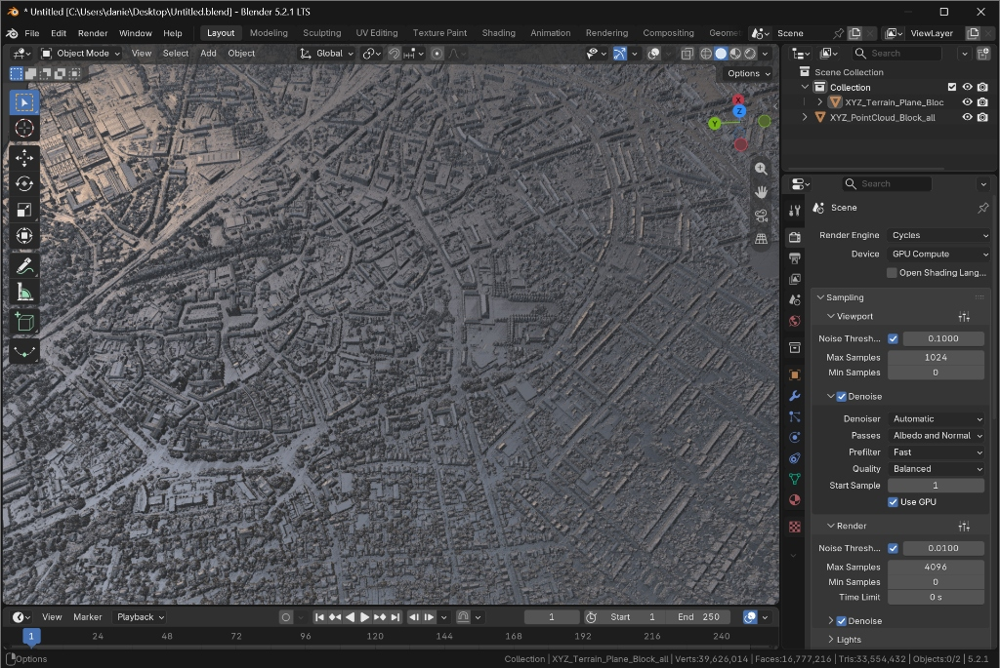
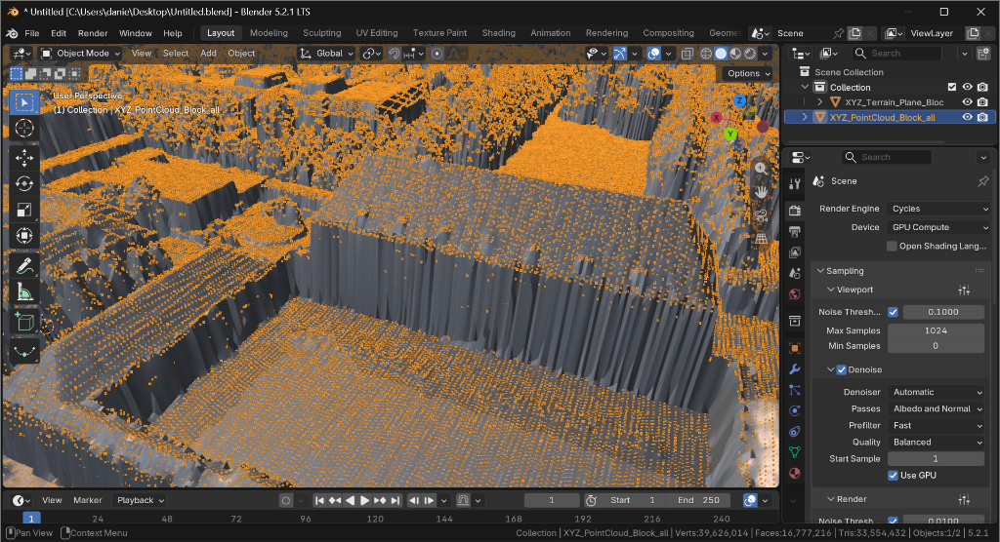

# XYZ Point Cloud to Heightmap / Mesh Importer for Blender

[](https://www.blender.org/)
[](LICENSE)
[](https://www.python.org/)

An advanced, high-performance **Blender 5.x Extension** for importing ASCII **XYZ point cloud data files** (`.xyz`, `.txt`, `.pts`) into Blender.

Convert real-world LiDAR, GIS, or DEM elevation data into **3D terrain meshes** or **32-bit floating-point heightmaps** complete with automated displacement shaders, IDW gap filling, and 16-bit PNG export capabilities.



---

## 🌟 Key Features

- **🚀 Multi-Format ASCII Parsing**: Fast C-level `numpy.fromfile` path for uniform whitespace tables with automatic fallback for `.pts` point-count headers, multi-column attributes (`X Y Z Intensity R G B`), comments (`#`, `//`, `;`), and CSV/semicolon delimiters.
- **⚡ Native Blender 5.x C-Buffer Geometry**: Populates millions of point cloud vertices and UV coordinates directly via `foreach_set` C-buffers without intermediate Python list allocations.
- **🗺️ Dual Generation Modes**:
  1. **2D Float Heightmap Grid**: Generates a 32-bit float texture buffer mapped onto a subdividible plane with an active `Displace` modifier and preconfigured material setup (`Non-Color` color space).
  2. **3D Delaunay/CDT Triangulated Mesh**: Uses Blender's native `mathutils.geometry.delaunay_2d_cdt` for clean, deterministic 2.5D surface triangulation directly from point clouds.
- **🧹 Noise Outlier Cleaning**: Automatic percentile filtering (`0.1%` to `99.9%` on clouds with $\ge 100$ points) to eliminate severe measurement noise spikes, plus optional hard elevation min/max thresholds.
- **🎯 Smart 3D Origin Centering**: Shifts geographic coordinates so the bounding box X/Y center and Z base sit cleanly at Blender's world origin (`0, 0, 0`) while preserving real-world offsets in custom object properties.
- **🌐 Physical-Space IDW Gap Filling**: Vectorized NumPy and `mathutils.kdtree.KDTree` Inverse Distance Weighting operating in physical meter coordinates to fill missing grid cells without anisotropic distortion.
- **💾 16-Bit PNG Heightmap Export**: Built-in utility operator to export generated heightmaps as 16-bit grayscale PNG images for game engines (Unreal Engine, Unity, Godot) or digital sculpting tools.

---

## 🛠️ Installation (Blender 5.0+ Extension System)

1. Download or clone this repository as a `.zip` archive or directory folder.
2. In Blender 5.0+, navigate to **Edit > Preferences > Get Extensions**.
3. Click the drop-down menu in the top right corner and select **Install from Disk...**.
4. Choose `xyz2heightmap.zip` (or select `blender_manifest.toml` inside the unzipped directory).
5. Ensure the extension is enabled.

---

## 📖 Usage Guide

The add-on adds a dedicated **XYZ Terrain** tab to the **3D Viewport Sidebar (N-Panel)**, organized into a clean 3-step workflow (and also supports direct one-click import via **File > Import > XYZ Point Cloud (.xyz/.pts/.txt)**):

### Step 1: Import XYZ Point Cloud
1. Open the N-Panel (press `N` in the 3D Viewport) and navigate to the **XYZ Terrain** tab.
2. Select your `.xyz`, `.txt`, or `.pts` dataset in **File Path**.
3. Configure alignment & filtering options:
   - **Center to Scene Origin (0,0,0)**: Aligns terrain X/Y center and Z base to `(0, 0, 0)`.
   - **Auto-Filter Noise Outliers**: Cleans extreme elevation spikes.
   - **Use Manual Elevation Filter**: Enforce explicit min/max height limits (in meters).
4. Click **Import Point Cloud**. This imports a point cloud geometry object into the scene.

### Step 2: Generate 2D Heightmap Grid & Displacement
1. Select the imported point cloud object in your viewport.
2. Set your desired resolution:
   - **Pixels per Meter (PPM)**: Automatically calculates image dimensions based on terrain physical size.
   - **Custom Resolution**: Explicitly define pixel width & height (e.g. `2048x2048`, `4096x4096`).
3. Set **IDW Neighbors** (number of nearest points used for interpolation).
4. Set **Subdivision Levels** for viewport detail.
5. Click **Generate Heightmap Plane**.
   - *Result*: Creates a displaced terrain plane with explicit UV coordinates, generates a 32-bit float texture, applies a `Displace` modifier set to physical Z-amplitude, and creates a preconfigured Cycles/Eevee material with `Non-Color` space settings.


*Close-up viewport inspection: raw XYZ point cloud vertices (orange) aligned seamlessly on top of the displaced 32-bit float terrain surface.*

### Step 3: Generate 3D Delaunay Mesh (Alternative)
1. Select the imported point cloud object (or generated heightmap plane).
2. Set **Detail Density (%)** to control vertex sampling density (`0.1%` to `100%`).
3. Set **Max Vertex Cap** for viewport safety.
4. Click **Generate Triangulated Mesh**.
   - *Result*: Generates a 3D triangulated mesh object representing the terrain surface.

### Step 4: Export 16-Bit PNG Heightmap
1. Under **2. Heightmap Plane Generator**, set your output path (e.g. `//heightmap_16bit.png` in a saved `.blend` project or an absolute file path).
2. Click **Export 16-Bit PNG**. The heightmap is saved as a 16-bit single-channel grayscale PNG image.

---

## 🏗️ Architecture & Codebase Structure

```
xyz2heightmap/
├── __init__.py                   # Extension entry point & class registration
├── blender_manifest.toml         # Blender 5.0+ Extension manifest specification
├── pyproject.toml                # Unified pytest, ruff, and pyright configuration
├── xyz_parser.py                 # Pure Python/NumPy parser & immutable bounding box model
├── heightmap_generator.py        # Heightmap rasterizer, physical-space IDW & Blender Image I/O
├── mesh_generator.py             # Context-free mesh builder & Delaunay 2.5D triangulation
├── import_operator.py            # PropertyGroup & UI execution operators
├── ui_panel.py                   # N-Panel 3D Viewport layout panels
├── assets/                       # Documentation screenshots & visual assets
├── tests/                        # Automated unit & headless Blender integration test suite
│   ├── test_xyz_parser.py
│   ├── test_heightmap_generator.py
│   └── test_blender_addon.py
├── CONTRIBUTING.md               # Developer setup & quality guidelines
├── LICENSE                       # GNU General Public License v3.0
└── README.md                     # Project documentation
```

---

## 🧪 Running Tests & Quality Gates

To run the automated unit test suite locally:

```bash
python -m pytest -v
```

To run Ruff linting and Pyright static type checks:

```bash
python -m ruff check .
python -m pyright
```

To run the headless Blender end-to-end integration test:

```bash
blender --background --factory-startup --python-exit-code 1 --python tests/test_blender_addon.py
```

---

## 📜 License

Distributed under the **GNU General Public License v3.0 (GPLv3)**. See [`LICENSE`](LICENSE) for more information.
